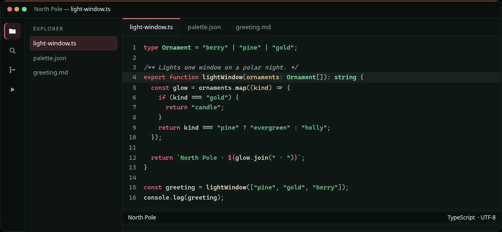

# North Pole

A dark Visual Studio Code theme for the holiday season. Polar night in the background, holly for keywords, evergreen for strings, candle gold for numbers, and snow for the words in between.

The mark, palette, and preview are original. No characters from anyone else's stories.



## Preview

The holiday preview is a single page that paints this palette onto an editor, with sample TypeScript, JSON, and Markdown.

- Locally: `npm run preview`, then open [http://localhost:4173](http://localhost:4173)
- After this lands on `master`: [m-fin.github.io/north-pole](https://m-fin.github.io/north-pole/)

GitHub Pages deploys the `site/` folder with Actions. The repository needs Pages set to **GitHub Actions** once (Settings → Pages → Build and deployment → Source).

## Install

From the marketplace, once 1.0.0 is published:

```bash
ext install m-fin.north-pole
```

From this repo:

```bash
npm install
npm test
npm run package
code --install-extension dist/north-pole.vsix
```

Then choose **North Pole** from the Color Theme picker.

## Run it while editing

Open this folder in VS Code and launch **Run North Pole** (or press F5). In the Extension Development Host, open the Color Theme picker and select North Pole. Saves to the theme file reload there.

## Palette

| Role | Color | Hex |
| --- | --- | --- |
| Polar night | editor background | `#101816` |
| Snow | editor text | `#e7f6ef` |
| Spruce | comments | `#8eaa9c` |
| Holly | keywords | `#ff6b81` |
| Evergreen | strings | `#5ee0a0` |
| Candle | numbers | `#d9a441` |
| Mint | types | `#7dffc3` |
| Warm snow | functions | `#fff4d8` |

Comments in the 2019 theme were `#333333` on `#111111`. That pair is about 1.4:1. Spruce on polar night is above 7:1, and the other code colors clear 4.5:1. `npm test` checks those ratios, along with the package manifest and the preview page.

## License

[MIT](LICENSE) © 2026 Matthew Finley
